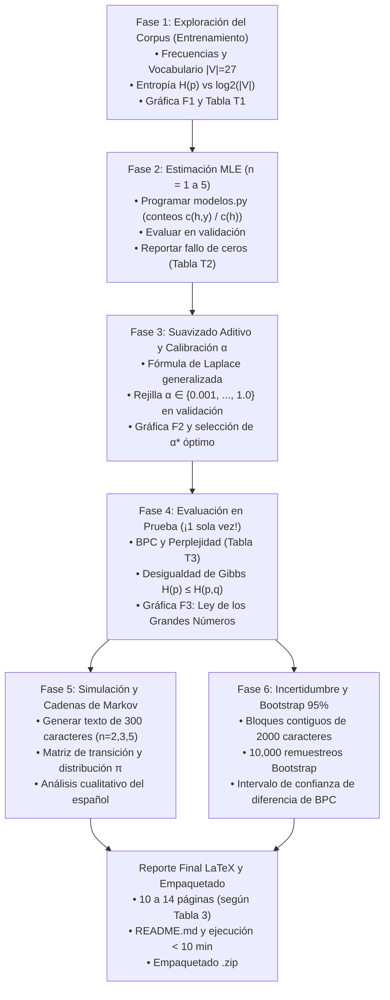

# Plan de Trabajo: Tareas a Realizar y Orden Cronológico

**Proyecto Final de Teoría de la Probabilidad: Modelos de $n$-gramas para el Idioma Español**  
**Facultad Experimental de Ciencias y Tecnología (FaCyT) — Universidad de Carabobo**  
*Noviembre de 2026*

---

## 📌 1. Fuentes Consultadas y Base Metodológica

Para la elaboración de este plan maestro de trabajo y la estructuración del orden de tareas, se han tomado como fuentes directas y exclusivas:

1. **Guía Conceptual y Plan de Trabajo en Equipo (Documento PDF del Proyecto):**  
   Síntesis metodológica que define el objetivo central, la intuición probabilística de los modelos de $n$-gramas ($n=1, \dots, 5$), la problemática del sobreajuste y la probabilidad cero, la partición 80/10/10 contigua, las 6 Fases experimentales, la prueba de cordura con *«abracadabra»* (Tabla 1), la división funcional para 4 integrantes (Tabla 2), el cronograma de 4 semanas y la lista de comprobación final.
2. **Corpus Literario en el Repositorio (`ProyectoProbabilidad/libro/`):**  
   La obra literaria seleccionada: ***Niebla (Nivola)*** de **Miguel de Unamuno** (1914), en sus versiones original (`Niebla_original_gutenberg.txt`), limpia sin notas editoriales (`Niebla_limpio.txt`, 342,808 bytes) y base (`Niebla.txt`).
3. **Estado Actual del Repositorio (`ProyectoProbabilidad`):**  
   - `decisiones_informe.md`: Bitácora que documenta las decisiones ya consolidadas (corpus de 315,783 caracteres, alfabeto normalizado de $|\mathcal{V}| = 27$ caracteres, regla del token numeral `#`, división contigua sin mezcla y validación de `abracadabra`).
   - `codigo/preparar.py`: Script funcional que limpia, normaliza y particiona los datos.
   - `codigo/pruebas.py`: Script funcional que implementa y valida con 100% de exactitud la prueba de cordura de la Tabla 1.
   - `datos/`: Bloques contiguos listos (`entrenamiento.txt`, `validacion.txt`, `prueba.txt`, `texto_normalizado.txt` y `FUENTE.md`).
   - `proyecto_S01_probabilidad.pdf`: Enunciado formal con las pautas de evaluación y rúbrica del curso.

---

## 🚦 2. Estado Actual del Proyecto (Lo que ya está completado)

| Hito / Tarea | Estado | Evidencia en el Repositorio |
| :--- | :---: | :--- |
| **Selección y descarga de la obra** | ✅ Completado | `libro/Niebla_limpio.txt` (Project Gutenberg #49836, >300,000 caracteres). |
| **Limpieza editorial y normalización** | ✅ Completado | `codigo/preparar.py` (minúsculas, colapso `\s+`, alfabeto $a$–$z$, `' '` y `#`). |
| **Partición contigua (80% / 10% / 10%)** | ✅ Completado | `datos/entrenamiento.txt` (252,626 car.), `validacion.txt` (31,578 car.), `prueba.txt` (31,579 car.). |
| **Prueba de cordura inicial (`abracadabra`)** | ✅ Completado | `codigo/pruebas.py` pasa con 100% de coincidencia matemática con la Tabla 1. |
| **Bitácora metodológica inicial** | ✅ Completado | `decisiones_informe.md` y `datos/FUENTE.md`. |

---

## 📋 3. Tareas Pendientes Ordenadas por Fases (Fases 1 a 6)

El desarrollo del proyecto debe seguir un orden estrictamente secuencial para evitar cuellos de botella y asegurar que cada fase se alimente de los resultados verificados de la anterior:



---

### 🔹 FASE 1: Exploración del Corpus y Regularidad del Español
* **Objetivo:** Responder probabilísticamente: *¿Qué tan ordenado y redundante es el español literario de Unamuno comparado con el azar?*
* **Tareas a ejecutar:**
  1. Leer exclusivamente el archivo `datos/entrenamiento.txt`.
  2. Contar la frecuencia absoluta $c(x)$ y frecuencia relativa $\hat{p}(x) = c(x) / N_{\text{ent}}$ para cada uno de los caracteres del vocabulario $\mathcal{V}$ ($|\mathcal{V}| = 27$).
  3. Ordenar los caracteres de mayor a menor frecuencia y generar la **Tabla T1** y la **Gráfica F1** (gráfico de barras de frecuencias de unigramas).
  4. Calcular la **Entropía empírica de Shannon**:
     $$H(\hat{p}) = -\sum_{x \in \mathcal{V}} \hat{p}(x) \log_2 \hat{p}(x)$$
  5. Calcular la **Entropía máxima teórica** bajo distribución uniforme:
     $$H_{\max} = \log_2 |\mathcal{V}| = \log_2(27) \approx 4.7549 \text{ bits}$$
  6. Calcular la redundancia del texto $R = 1 - \frac{H(\hat{p})}{H_{\max}}$ e interpretar cuánta certidumbre aporta conocer las frecuencias del idioma.

---

### 🔹 FASE 2: Estimación por Máxima Verosimilitud (MLE) y el Problema de los Ceros
* **Objetivo:** Construir los modelos empíricos de $n$-gramas ($n = 1, 2, 3, 4, 5$) y demostrar experimentalmente por qué la MLE pura fracasa al evaluar texto no visto.
* **Tareas a ejecutar:**
  1. Crear el módulo `codigo/modelos.py` con clases o funciones reutilizables:
     - Conteo de contextos de longitud $n-1$: $c(h)$.
     - Conteo de secuencias conjuntas de longitud $n$: $c(h, y)$.
     - Probabilidad condicional MLE:
       $$\hat{q}_{\text{MLE}}(y \mid h) = \frac{c(h, y)}{c(h)}$$
  2. Ajustar los 5 modelos ($n = 1, 2, 3, 4, 5$) usando `datos/entrenamiento.txt`.
  3. Evaluar cada modelo sobre el bloque de `datos/validacion.txt`:
     - Detectar todas las transiciones $(h, y)$ de validación donde $c(h, y) = 0$ o $c(h) = 0$.
     - Registrar que la probabilidad asignada es $\hat{q}(y \mid h) = 0$, lo que conduce a $\log_2(0) \to -\infty$ y un error BPC infinito.
  4. Construir la **Tabla T2**: Número de parámetros posibles ($|\mathcal{V}|^n$), número de secuencias únicas observadas y porcentaje de ceros encontrados en validación para cada $n \in \{1, 2, 3, 4, 5\}$.

---

### 🔹 FASE 3: Suavizado Aditivo (Laplace Generalizado) y Calibración de $\alpha$
* **Objetivo:** Resolver el problema de los ceros asignando una pseudomasa $\alpha > 0$ y encontrar el $\alpha^*$ óptimo para cada orden $n$.
* **Tareas a ejecutar:**
  1. Implementar en `codigo/modelos.py` la probabilidad condicional con suavizado aditivo:
     $$\hat{q}_\alpha(y \mid h) = \frac{c(h, y) + \alpha}{c(h) + \alpha |\mathcal{V}|}$$
     *(Asegurar que cuando el contexto nunca fue visto, $c(h)=0$, la probabilidad se degrade naturalmente a la uniforme $1/|\mathcal{V}|$).*
  2. Definir en `codigo/experimentos.py` la rejilla de calibración de hiperparámetros:
     $$\alpha \in \{0.001, 0.003, 0.01, 0.03, 0.1, 0.3, 1.0\}$$
  3. Para cada orden $n \in \{1, 2, 3, 4, 5\}$ y cada valor de $\alpha$:
     - Evaluar sobre `datos/validacion.txt` calculando los Bits Por Carácter (BPC):
       $$\text{BPC}(n, \alpha) = -\frac{1}{N_{\text{val}} - n + 1} \sum_{t=n}^{N_{\text{val}}} \log_2 \hat{q}_\alpha(x_t \mid x_{t-n+1}^{t-1})$$
  4. Graficar la curva de BPC vs $\alpha$ para cada $n$ (**Gráfica F2**).
  5. Identificar y guardar el valor óptimo $\alpha^*(n)$ que minimice el BPC de validación para cada modelo.

---

### 🔹 FASE 4: Evaluación en Bloque de Prueba y Comprobaciones Teóricas
* **Objetivo:** Evaluar **una sola vez** el bloque definitivo de prueba con los modelos ya calibrados y verificar empíricamente los teoremas probabilísticos fundamentales.
* **Tareas a ejecutar:**
  1. Fijar los mejores hiperparámetros $\alpha^*(n)$ obtenidos en la Fase 3.
  2. Cargar `datos/prueba.txt` y correr la evaluación una única vez.
  3. Calcular y reportar para cada orden $n \in \{1, 2, 3, 4, 5\}$:
     - **Bits Por Carácter (BPC)**.
     - **Perplejidad (PPL):** $\text{PPL} = 2^{\text{BPC}}$.
  4. Generar la **Tabla T3** con los resultados comparativos de prueba.
  5. **Verificación de la Desigualdad de Gibbs:**
     - Comprobar numéricamente que la entropía cruzada siempre acota superiormente a la entropía real:
       $$H(p) \le H(p, q) \iff \text{BPC} \ge H(p)$$
  6. **Comprobación de la Ley de los Grandes Números (LLN):**
     - Calcular el promedio acumulado de sorpresa bit a bit a lo largo de las 31,579 posiciones de prueba:
       $$S_k = -\frac{1}{k} \sum_{t=1}^k \log_2 \hat{q}(x_t \mid h_t)$$
     - Generar la **Gráfica F3**, mostrando cómo $S_k$ oscila al principio y se estabiliza asintóticamente alrededor de la media teórica esperada.

---

### 🔹 FASE 5: Simulación y Teoría de Cadenas de Markov
* **Objetivo:** Generar texto artificial a partir de los modelos entrenados y analizar analíticamente la convergencia a la distribución estacionaria.
* **Tareas a ejecutar:**
  1. Implementar la función de generación estocástica de texto:
     - A partir de un prefijo o contexto semilla inicial fijo (ej. `"el "` o `"habia "`), muestrear sucesivamente el siguiente carácter según la distribución multinomial $\hat{q}(y \mid h)$.
  2. Generar secuencias sintéticas de **300 caracteres** para los modelos $n = 2$ (bigramas), $n = 3$ (trigramas) y $n = 5$.
  3. Analizar cualitativamente qué propiedades del idioma se capturan (formación de sílabas, alternancia consonante-vocal, palabras válidas del español, concordancia y cuándo se pierde el sentido semántico).
  4. **Análisis de Cadena de Markov para $n = 2$:**
     - Construir la matriz de transición de estados $P$ de tamaño $27 \times 27$.
     - Verificar que es una matriz estocástica (suma de cada fila igual a 1).
     - Calcular analíticamente o por el método de potencias la **distribución estacionaria** $\pi$:
       $$\pi P = \pi, \quad \sum_{i=1}^{27} \pi_i = 1$$
     - Comparar formalmente el vector $\pi$ con las frecuencias empíricas de unigramas de la Fase 1, demostrando la propiedad ergódica de la cadena.

---

### 🔹 FASE 6: Cuantificación de la Incertidumbre (Bootstrap por Bloques)
* **Objetivo:** Determinar con rigor estadístico si la diferencia de rendimiento entre el mejor modelo y los demás es significativa o fruto del azar.
* **Tareas a ejecutar:**
  1. Identificar el mejor orden $n^*$ y el segundo mejor modelo competidor.
  2. Dividir el bloque `datos/prueba.txt` en bloques contiguos de $L = 2000$ caracteres (para preservar la dependencia local de Markov).
  3. Implementar el algoritmo de **Bootstrap no paramétrico por bloques**:
     - Realizar $B = 10\,000$ remuestreos con reemplazo sobre los bloques.
     - En cada remuestreo $b$, calcular la diferencia de BPC:
       $$\Delta^{(b)} = \text{BPC}_{\text{segundo}}^{(b)} - \text{BPC}_{\text{mejor}}^{(b)}$$
  4. Construir el **Intervalo de Confianza del 95%** utilizando el método de percentiles ($[q_{0.025}, q_{0.975}]$).
  5. Graficar el histograma de la distribución Bootstrap de $\Delta$ (**Gráfica F4**).
  6. Concluir si $0$ está fuera del intervalo, demostrando estadísticamente la superioridad del modelo ganador al nivel de significancia $\alpha = 0.05$.

---

## 👥 4. Distribución de Roles y Tareas (Equipo de 4 Personas)

Siguiendo la estructura sugerida en la Tabla 2 de la guía:

```
┌──────────────────────────────────────────────────────────────────────────────┐
│                      DISTRIBUCIÓN MODULAR DEL EQUIPO                         │
├───────────────────────────────┬──────────────────────────────────────────────┤
│ Integrante                    │ Responsabilidades Principales                │
├───────────────────────────────┼──────────────────────────────────────────────┤
│ 👤 PERSONA 1                  │ • Documentación del corpus y libro Niebla    │
│ Ingeniero de Datos y          │ • Mantenimiento de preparar.py y datos/      │
│ Preprocesamiento              │ • Implementación de Fase 1 (vocabulario,     │
│                               │   entropía H(p), Gráfica F1 y Tabla T1)      │
├───────────────────────────────┼──────────────────────────────────────────────┤
│ 👤 PERSONA 2                  │ • Programación central de modelos.py         │
│ Arquitecto de Modelos         │ • Conteos eficientes de n-gramas (n = 1 a 5) │
│ Probabilísticos               │ • Probabilidades MLE y Suavizado Aditivo     │
│                               │ • Mantenimiento de pruebas.py (abracadabra)  │
├───────────────────────────────┼──────────────────────────────────────────────┤
│ 👤 PERSONA 3                  │ • Programación de experimentos.py            │
│ Experimentación y             │ • Barrido de rejilla α (Fase 3, Gráfica F2)  │
│ Simulación                    │ • Evaluación única en prueba (Fase 4, Tab T3)│
│                               │ • Simulación de texto y Markov π (Fase 5)    │
│                               │ • Bootstrap por bloques al 95% (Fase 6)      │
├───────────────────────────────┼──────────────────────────────────────────────┤
│ 👤 PERSONA 4                  │ • Plantilla LaTeX (10 a 14 págs., normas)    │
│ Líder de Reporte y            │ • Redacción formal del marco teórico         │
│ Reproducibilidad              │ • Integración de tablas (.csv) y figuras     │
│                               │ • README.md y ejecución global < 10 minutos  │
└───────────────────────────────┴──────────────────────────────────────────────┘
```

---

## 📅 5. Cronograma de Trabajo Sugerido (4 Semanas)

### 🗓️ Semana 1: Cimientos y Preprocesamiento *(ESTADO: 90% Completada)*
* [x] Selección del libro *Niebla* y delimitación editorial sin paratexto.
* [x] Implementación de `preparar.py` y partición contigua 80/10/10 en `datos/`.
* [x] Implementación y validación de `pruebas.py` con *«abracadabra»*.
* [ ] **Pendiente:** Ejecutar conteos de Fase 1 sobre `entrenamiento.txt` y calcular $H(\hat{p})$ vs $H_{\max}$ (Gráfica F1 y Tabla T1).

### 🗓️ Semana 2: Modelado Probabilístico y Calibración
* [ ] Programar `codigo/modelos.py` con conteos para $n = 1, 2, 3, 4, 5$.
* [ ] Demostrar el fallo de ceros en validación (Fase 2, Tabla T2).
* [ ] Implementar suavizado de Laplace generalizado en `modelos.py`.
* [ ] Realizar la calibración de $\alpha \in \{0.001, \dots, 1.0\}$ sobre `datos/validacion.txt` (Fase 3, Gráfica F2).
* [ ] **Hito:** Revisión 1 con el profesor con los mejores $\alpha^*$ seleccionados.

### 🗓️ Semana 3: Evaluación en Prueba, Simulación e Incertidumbre
* [ ] Correr la evaluación definitiva sobre `datos/prueba.txt` una única vez (Fase 4, Tabla T3).
* [ ] Generar gráfica de la Ley de los Grandes Números (Gráfica F3) y verificar Desigualdad de Gibbs.
* [ ] Simular textos de 300 caracteres y calcular la distribución estacionaria $\pi$ del bigrama (Fase 5).
* [ ] Ejecutar el remuestreo Bootstrap de 10,000 iteraciones con bloques de 2000 caracteres (Fase 6, Gráfica F4).
* [ ] **Hito:** Revisión 2 con el profesor con todos los resultados numéricos consolidados.

### 🗓️ Semana 4: Reporte Final, Reproducibilidad y Defensa
* [ ] Estructurar y redactar el reporte en LaTeX (10 a 14 páginas estrictas).
* [ ] Responder formalmente todas las preguntas de discusión teórica.
* [ ] Integrar figuras vectoriales (`.pdf`/`.png`) y tablas exportadas desde Python.
* [ ] Verificar que todo el flujo corra desde la consola en menos de 10 minutos (`python3 main.py` o scripts individuales).
* [ ] Redactar `README.md` final con instrucciones reproducibles paso a paso.
* [ ] Ensayar la sincronización de 20 minutos entre los 4 integrantes para la defensa oral aleatoria de 10 minutos.
* [ ] Empaquetar el archivo final `P1_EquipoNN_Apellido1_Apellido2.zip`.

---

## 🎯 6. Lista de Comprobación Antes de Entregar (Checklist de Seguridad)

Antes de comprimir y enviar la entrega final, el equipo debe verificar cada una de estas casillas obligatorias:

- [ ] **Resumen ejecutivo:** Incluye el mejor orden $n^*$ hallado, su BPC de prueba y el intervalo de confianza Bootstrap del 95%.
- [ ] **Glosario y notación:** Cada variable matemática ($n, \mathcal{V}, h, y, \alpha, \text{BPC}, \text{PPL}$) está definida antes de su primer uso formal.
- [ ] **Protocolo de prueba ciega:** El bloque `datos/prueba.txt` se utilizó estrictamente una sola vez y el reporte lo declara formalmente.
- [ ] **Blindaje de código:** El script `codigo/pruebas.py` se ejecuta sin errores y reproduce con total exactitud las cifras de *«abracadabra»* de la Tabla 1.
- [ ] **Tablas y figuras:** Las tablas (T1 a T4) y figuras (F1 a F5) están numeradas, citadas en el texto y expresadas con unidades claras (bits, caracteres).
- [ ] **Preguntas de discusión:** Cada pregunta conceptual en cursiva de la sección 4 del enunciado cuenta con respuesta detallada en la sección de discusión del reporte.
- [ ] **Referencias bibliográficas:** Se citan debidamente la obra *Niebla* de Miguel de Unamuno (Gutenberg #49836), el libro de texto del curso (Luis Rincón) y las notas de S01.
- [ ] **Nombre del archivo comprimido:** Sigue la nomenclatura exacta `P1_EquipoNN_Apellido1_Apellido2.zip` y corre de principio a fin en menos de 10 minutos.
